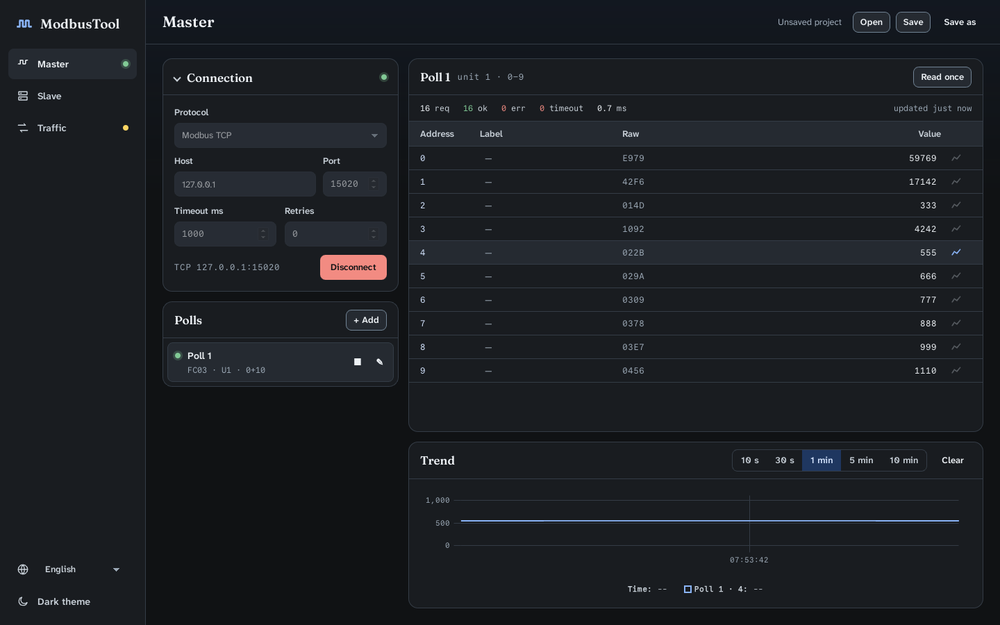
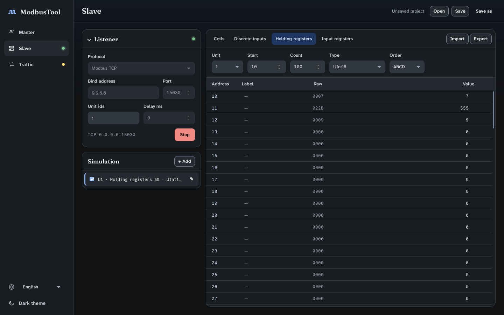
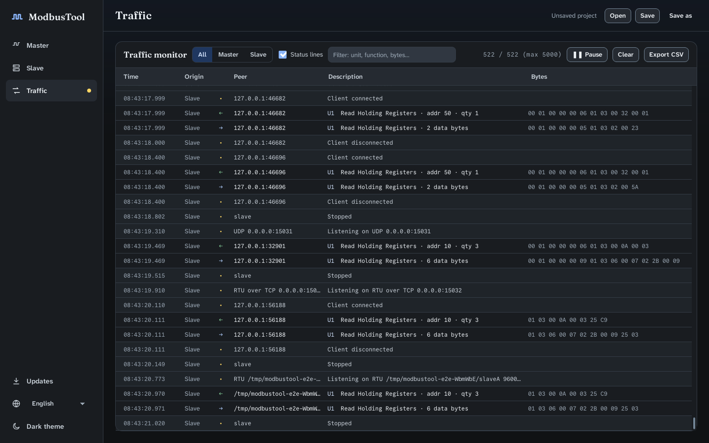

# ModbusTool

A Modbus **master and slave** tool for Windows and Linux (macOS can be built from source).
Version 3 is a full rewrite of the WinForms tool as a [Tauri](https://tauri.app) desktop app:
Rust backend, Svelte frontend, one window for both roles.



## Features

**Links** — Modbus TCP, Modbus UDP, RTU over TCP, RTU serial, ASCII serial.

**Master**
- Functions FC01–FC06, FC15, FC16.
- Several polls running at the same time, each with its own unit, function, address range and
  interval; per-poll statistics (requests, ok, errors, timeouts, response time).
- Edit values in the grid to write them (FC05 for coils, FC06 for one register, FC16 for more).
- Timeout and retries.

**Slave**
- Several unit ids, each with its own four tables of 65 536 elements.
- Response delay, broadcast writes (unit 0).
- Value generators: sine, ramp, random, square wave.
- CSV import/export (also reads the ModbusTool 2 export format `4100:0x04c8,4101:12,...`).

**Both**
- Data types: UInt16, Int16, Hex, Binary, UInt32, Int32, Float32, UInt64, Int64, Float64, ASCII,
  with byte orders ABCD, CDAB, BADC, DCBA. Labels per register.
- Traffic monitor, frame by frame, with decoded descriptions, filters and CSV export.
- Live trend chart of any value.
- Projects saved as JSON (`Ctrl+S`, `Ctrl+O`). Dark and light theme, same design as Aura.

| Slave | Traffic monitor |
|---|---|
|  |  |

## Install

Download the installer for your system from the latest successful
[CI run](https://github.com/chetto1983/ModbusTool/actions/workflows/ci.yml) artifacts
(`.msi`/`.exe` for Windows, `.deb`/`.AppImage` for Linux). macOS is not built in CI: run `npx tauri build` on a Mac.

## Known limits

Measured with tests, see `docs/superpowers/specs/2026-11-05-tauri-rewrite-design.md`:

- Over TCP/UDP a single read is limited to 123 registers (the protocol allows 125) and the slave
  accepts writes of up to 121 registers: the frame codec ([rmodbus](https://crates.io/crates/rmodbus))
  caps frames at 255 bytes.
- The slave does not answer FC 0x2B (device identification) over TCP.
- FC22 (mask write) and FC23 (read/write multiple) are not supported yet.
- Serial parity mark/space and 1.5 stop bits are not available.

## Development

Requirements: Rust (stable), Node.js 22, and on Linux
`libwebkit2gtk-4.1-dev libayatana-appindicator3-dev librsvg2-dev libudev-dev`.

```sh
npm ci
npx tauri dev            # run the app with hot reload
npx tauri build          # installers in src-tauri/target/release/bundle
```

Checks (the same as CI):

```sh
npm run check && npm test && npm run build
cd src-tauri && cargo fmt --check && cargo clippy --all-targets -- -D warnings && cargo test
```

End-to-end run of the real app against [pymodbus](https://github.com/pymodbus-dev/pymodbus) as an
independent implementation (Linux; needs `tauri-driver`, `WebKitWebDriver`, `socat`, `pymodbus`):

```sh
npx tauri build --debug --no-bundle
node e2e/run.mjs docs/screenshots
```

Project rules for contributors and coding agents are in [CLAUDE.md](CLAUDE.md).

## License

MIT, see [LICENSE](LICENSE). Version 3 shares no code with the earlier C# releases, which were
published under the Apache License 2.0 and remain so in the git history.

The interface follows the design tokens of [Aura](https://github.com/chetto1983/Aura). Bundled
fonts (Fraunces, Atkinson Hyperlegible Next, Commit Mono) are under the SIL Open Font License 1.1,
see [src/assets/fonts/OFL.txt](src/assets/fonts/OFL.txt).
